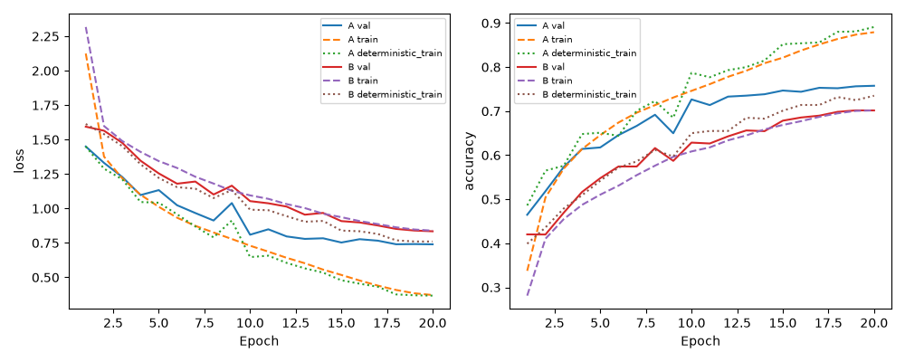

# CIFAR-10：小型 CNN 与数据增强对照

使用自建三块 CNN，比较 A（无随机增强）与 B（RandomCrop(32, padding=4) + RandomHorizontalFlip）。两组各训练 20 轮、共用一个训练种子和同一训练/验证划分。验证结果用于选 checkpoint，官方测试集仅在配置和权重锁定后用于最终评估。

## 已完成的真实结果

| 组别 | 训练轮数 | 最佳验证轮次 | 最佳验证准确率 | 对应验证 loss | 测试正确数 / 总数 | 测试准确率 |
|---|---:|---:|---:|---:|---:|---:|
| A 无随机增强 | 20 | 20 | 75.76% | 0.739963 | 7,601 / 10,000 | 76.01% |
| B 随机裁剪＋翻转 | 20 | 19 | 70.18% | 0.839923 | 7,109 / 10,000 | 71.09% |

仅运行训练种子 42，不能估计跨种子方差；当前结果不支持将增强效果推广到其他预算或模型。测试结果不用于调参、重训或重新选择权重。



曲线中的 `train` 是训练模式下在线记录的指标，B 包含随机增强。`deterministic_train` 是固定 1,000 张训练子集、确定性预处理、eval 模式下的指标，用于与同轮验证指标比较；它不是整个训练集的准确率。

## 环境与依赖

实际环境：Windows、Python 3.11.9、PyTorch 2.15.0+cpu、torchvision 0.29.2+cpu、NumPy 2.4.6、Matplotlib 3.11.2。计算使用 CPU 4 线程，16 个逻辑处理器，CUDA 不可用。更换系统或硬件后，数值和耗时可能有差异。

以下命令在仓库根目录用 PowerShell 执行；仅为新环境复现提供，不需要为查看已保存结果再次训练或测试。

```powershell
python -m venv .venv
.\.venv\Scripts\python.exe -m pip install torch==2.15.0+cpu torchvision==0.29.2+cpu --index-url https://download.pytorch.org/whl/cpu
.\.venv\Scripts\python.exe -m pip install -r requirements.txt
.\.venv\Scripts\python.exe experiment.py env
```

`requirements.txt` 列出运行所需的直接依赖；`requirements-lock.txt` 是原环境完整版本快照，包含此前读取作业说明所用的 pypdf，但训练与评估不依赖 pypdf。需要复现完整环境时，在安装官方 CPU torch/torchvision 后执行 `pip install -r requirements-lock.txt`。官方安装来源：[PyTorch](https://pytorch.org/get-started/locally/)。

## 数据划分与预处理

数据：[CIFAR-10](https://www.cs.toronto.edu/~kriz/cifar.html)，32×32 RGB，10 类。仅在原始 50,000 张训练图像中，按类别分层划分 45,000 训练、5,000 验证；每类分别 4,500 / 500，划分种子 2026。A/B 使用同一份索引，保存在运行时生成的 `data/split.npz`。

均值和标准差只由未增强的 45,000 张训练子集计算。训练/验证使用不同数据实例；验证和测试只做 ToTensor + Normalize。训练流程只校验和打开五个训练 batch，不打开官方 test_batch。下载档案包含测试文件，但训练、调参和选权重均不使用它。

本次运行的划分文件 SHA256 为 `bd1ee89ce902184a3fd1cc52646a8348afb27b52cc8d8dc0bbb160ffa5b44c67`。两组配置同时保存归一化值与划分哈希。GitHub 材料不含数据集或划分二进制文件；复现时按固定种子重新生成索引。NPZ 容器的跨版本字节哈希可能不同，应在自己的新运行中使用同一份划分文件，不混用归档结果和新生成配置。

```powershell
.\.venv\Scripts\python.exe experiment.py prepare --download
.\.venv\Scripts\python.exe experiment.py smoke --epochs 20 --benchmark-images 4096 --threads 4
.\.venv\Scripts\python.exe verify_data_boundary.py
```

首次下载来自 torchvision 官方源。本次原始数据下载在官方源过慢时使用上海交通大学镜像，完整档案 MD5 为 `c58f30108f718f92721af3b95e74349a`，与 torchvision 官方值一致。原始数据未上传。

## 模型与共同训练设置

每个卷积块依次为 Conv(3×3, padding=1, bias=False)、BatchNorm、ReLU、MaxPool(2)。输入 N×3×32×32，三个块输出依次为 N×32×16×16、N×64×8×8、N×128×4×4；展平为 2,048 维后用线性层输出 10 类。可训练参数 **113,962**，未使用预训练模型。

两组共同设置：训练种子 42、相同初始化、batch size 128、20 轮；SGD(lr=0.05, momentum=0.9, weight_decay=0.0005)，CosineAnnealingLR(T_max=20)。采样使用独立 torch.Generator，种子 42，与随机增强状态隔离；生成器状态写入 checkpoint，A/B 每轮采样顺序一致。两组唯一预设差异是随机增强。

checkpoint 选择规则固定为：**最高验证 accuracy；同分取较早轮次**。因此 A 选第 20 轮，B 选第 19 轮。未根据测试结果更换权重。

## 训练、恢复与图表命令

以下用于从头复现。新运行目录必须不存在，避免覆盖；归档的公开结果保存在 `results/`，复现运行写入本地 `runs/`。

```powershell
.\.venv\Scripts\python.exe experiment.py train --group A --name A_seed42 --epochs 20
.\.venv\Scripts\python.exe experiment.py train --group B --name B_seed42 --epochs 20
# 中断后，使用相同配置恢复；不要对完整运行重复训练
.\.venv\Scripts\python.exe experiment.py train --group A --resume runs/A_seed42 --epochs 20
.\.venv\Scripts\python.exe experiment.py train --group B --resume runs/B_seed42 --epochs 20
# 画图命令从新运行读取指标，写入 results/validation_curves.png 与 summary.json
.\.venv\Scripts\python.exe experiment.py plot --runs runs/A_seed42 runs/B_seed42
```

每轮保存训练/验证 loss、accuracy、学习率、处理图像数及耗时。`best.pt` 是最佳验证权重，`last.pt` 含优化器、调度器和随机状态，用于恢复。锁定后拒绝继续训练。权重不包含在本仓库中，复现推理需先自行生成权重。

A/B 逐轮计时合计分别为 22.21 / 19.23 分钟，包含训练、验证及固定训练子集 eval，不含初始化与 checkpoint 磁盘写入。两组在 CPU 4 线程下顺序运行，后台负载和时钟未控制，不能据此认定随机增强使训练更快。每组累计处理 900,000 次训练图像、100,000 次验证图像和 20,000 次固定训练子集 eval。

## 最终评估与已有结果核对

下面是从头复现完成后使用的评估入口。实际两组已经完成一次最终评估；查看本仓库结果无需重新运行官方测试。

```powershell
.\.venv\Scripts\python.exe experiment.py lock --runs runs/A_seed42 runs/B_seed42
.\.venv\Scripts\python.exe experiment.py test --runs runs/A_seed42 runs/B_seed42
```

锁定前核对共同配置和当前 split.npz 哈希，锁定配置与 best.pt 的 SHA256；测试前再次检查。已有锁定必须匹配，已有测试目录不会被覆盖。本仓库保留原始锁定 JSON 和文件哈希以追溯所选权重。

**只核对已保存的公开产物**（标准库即可，不加载数据、权重，也不做推理）：

```powershell
python verify_results.py
```

该命令检查测试 JSON 是总体/每类指标对象而非训练日志、每组 20 轮训练记录、10,000 条预测、混淆矩阵与总体及每类准确率一致性、行归一化和归档文件 SHA256。原始验证脚本 `verify_completed_runs.py` / `verify_final_evaluation.py` 面向包含本地训练数据和权重的完整工作目录，分别用于锁定前训练检查与最终测试产物检查。

## 结果文件索引

两组分别在 `results/A_seed42/`、`results/B_seed42/`，目录与图内均标明 A/B：

| 文件 | 内容 |
|---|---|
| `A_train_metrics.json` / `B_train_metrics.json` | 各 20 轮训练、验证、固定训练子集 eval、学习率和耗时 |
| `A_test_metrics.json` / `B_test_metrics.json` | 直接复制官方测试产物：总体准确率、10 类准确率、每类样本数及权重来源 |
| `config.json`、`environment.json`、`completed.json` | 正式设置、实际设备与版本、完成状态 |
| `locked.json`、`artifact_hashes.json` | 原始配置/权重及训练指标的哈希证据，不含权重 |
| `confusion_raw.csv` / `.png` | 原始混淆矩阵；行是真实类别，列是预测类别 |
| `confusion_normalized.csv` / `.png` | 按真实类别行归一化 |
| `predictions.csv` | 0–9999 索引、真实标签、预测标签、最大 softmax 置信度 |
| `errors.png`、`error_selection.json` | 高频混淆类别对的低/高置信度错分与选择索引 |

错分选择规则：每组最高频的两个有向非对角类别对，数量平局按类别索引；每对保留最低和最高置信度样本，置信度平局按索引排序取端点。softmax 置信度不是校准概率，样例只展示观察到的错误，不能证明错误原因。

汇总图为 `results/AB_validation_curves.png`；逐轮验证汇总为 `results/validation_summary.json`。每类测试结果见各组测试 JSON。所有发布数字与图片来自原始运行产物；本材料不含最终报告。

## 仓库范围

只包含源码、依赖说明、配置、指标、必要结果图和逐样本预测。数据集、虚拟环境、模型权重、本机绝对路径日志、作业 PDF、临时提示词和操作记录均排除。上传目录只用于审阅，尚未发布到 GitHub。
